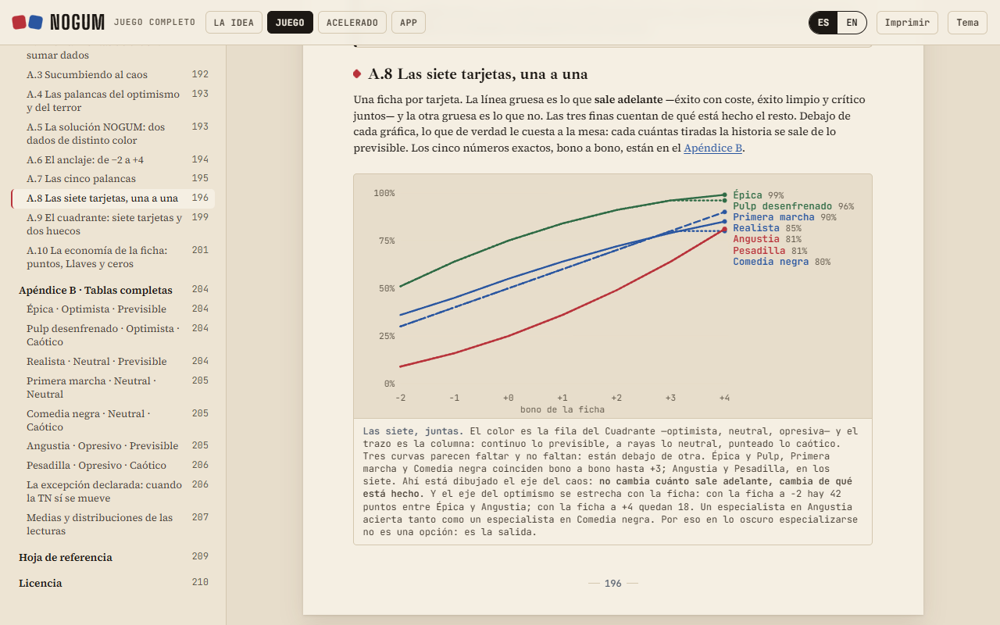
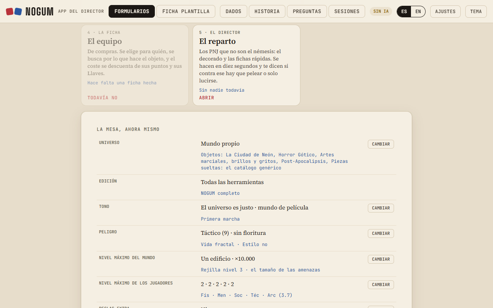

# NOGUM

[](https://github.com/epifaneia/nogum/actions/workflows/puertas.yml)

*Read this in [English](README.md).*

**NOGUM es un juego de rol de mesa. Este repositorio es el compilador de su manual bilingüe de 221 páginas, con validación automática de contenido, y la aplicación web que lo configura.**

El producto es un juego de rol universal. Lo interesante desde aquí es el problema: mantener **cuatro productos derivados de una misma fuente, en dos idiomas, con datos compartidos entre un libro y una aplicación**, sin que se desincronicen. Este repositorio es el pipeline que lo resuelve y las puertas de validación que lo vigilan.

🔗 **[Leerlo publicado](https://epifaneia.dev/nogum/)**: [la idea](https://epifaneia.dev/nogum/idea.html) · [el libro](https://epifaneia.dev/nogum/juego.html) · [la app](https://epifaneia.dev/nogum/app.html)





> **Por qué está aquí.** El principio de [Epifaneia](https://epifaneia.dev) es que *el modelo interpreta y el código determinista verifica*. Esto es ese principio llevado al extremo en un dominio donde la especificación era mía de arriba abajo: 221 páginas, dos idiomas, cuatro salidas y una aplicación que consume datos del propio libro.
>
> Las tres cosas que se demuestran son las mismas que se piden en un proceso regulado. **Trazabilidad:** cada regla lleva escrito de dónde sale, y el diario de diseño va por la entrada 189, cada decisión con su porqué. **Verificación automática:** las puertas paran la compilación cuando el contenido y los datos dejan de decir lo mismo. **Y restricción deliberada del modelo:** el configurador es determinista porque un árbol de veinte preguntas resuelve eso mejor que un modelo, y al asistente se le recorta el contexto para que nunca lea el diario de trabajo.
>
> El problema de fondo es el mismo que ataca [CTSM](https://github.com/epifaneia/ctsm) entre un requisito de cliente y un documento de proveedor: dos textos que debían decir lo mismo y dejaron de decirlo, sin que nadie se enterara. Aquí la diferencia es que el corpus es grande, vivo y bilingüe, y que las puertas llevan meses funcionando.

---

## El problema

Una misma fuente alimenta cuatro salidas que se contradicen con facilidad:

| Pieza | Qué es | Formato |
|---|---|---|
| La Idea | el argumento de diseño, 16 páginas | libro |
| Juego completo | el manual, 221 páginas (223 en inglés) | libro |
| Acelerado | la versión corta, 23 páginas | libro |
| App | el configurador y las fichas | aplicación de un fichero |

Cada libro sale en web y en PDF, y el PDF en dos versiones: para pantalla y para imprimir en casa. Son doce PDF por compilación.

Los tres libros se montan desde los mismos fragmentos. La aplicación consume **datos extraídos de esos fragmentos** (catálogo de equipo, reglas opcionales, recetas de mundo). Y todo existe en castellano y en inglés.

Las formas de romperlo son muchas y silenciosas: renombrar un concepto en el manual y no en los datos de la app; corregir una cifra en un idioma y no en el otro; expulsar un elemento de una lista y dejar seis referencias apuntando al de al lado.

## Cómo se resuelve

### Compilación

```
src/assemble3.py          los tres libros, dos idiomas, tres destinos
src/build_app3.py         la aplicación
src/extract_app_data.py   extrae datos del manual hacia la aplicación
src/extract_firmas.py     el catálogo de firmas del manual, para la aplicación
src/make_covers.py        portadas
src/imagenes.py           las imágenes, a los tamaños de la web (usa Pillow)
src/pdf/imprime.mjs       los PDF, con Chrome sin ventana, como el botón «Imprimir» del libro
src/pdf/marcadores.py     marcadores y metadatos de cada PDF (usa pypdf)
```

Tres destinos con enlaces distintos —carpeta local, artefactos, sitio público— resueltos en compilación, no a mano.

### Puertas de validación

Nada se publica sin pasar por aquí:

- **`src/w_revision.py`** — barre los productos compilados buscando vocabulario retirado, comprueba invariantes del sistema y revisa anclas rotas, identificadores duplicados y enlaces entre piezas.
- **`src/w_marcas_inv.py`** — inventario de marcas y nombres con derechos sobre lo publicado, con su contexto.
- **Aserciones en compilación** — que el número de recetas cuadre con el de tablas de techos; que el catálogo de reglas opcionales siga siendo de 18, porque el código de partida usa 18 bits; que los veinte mundos del atajo apunten a las veinte recetas una vez cada uno; que el documento JSON embebido en la aplicación siga siendo válido.
- **`src/curvas.py`** — el modelo de probabilidad del sistema, contrastado contra las tablas impresas del propio manual. Las ocho tablas del Apéndice B dan 56 filas comparadas por idioma y 0 discrepancias, y **`src/w_apendice_b.py`** lo vuelve a comprobar en cada compilación. De ahí salen también las gráficas SVG del libro, generadas desde los datos y no dibujadas a mano.

Tres ejemplos de fallos que estas puertas encontraron y que ninguna lectura humana había visto: un catálogo que repartía un valor de daño retirado **solo en la versión inglesa**; texto que la aplicación arrastraba con vocabulario que el manual ya había cambiado; y dos rutas de salida que en Windows eran el mismo fichero, de modo que los enlaces publicados apuntaban a copias locales inexistentes.

Cada puerta sale con código distinto de cero si encuentra algo, y la integración continua ([`.github/workflows/puertas.yml`](.github/workflows/puertas.yml)) compila y las pasa en cada push. La integración continua también comprueba que `docs/`, el sitio publicado, es exactamente lo que sale de la fuente: si alguien cambia un fragmento y no recompila, o retoca `docs/` a mano, falla y dice qué fichero se desvió.

### Una puerta en acción / A gate at work

El primero de esos tres es real y está en el diario (`src/CANON.md`, entrada T152, anterior al primer commit público): el tope de daño se había bajado a 2 en castellano y no en inglés, y el Lanzallamas Casero y la Gema del Infinito seguían repartiendo 3 solo en la versión inglesa. Lo destapó el barrido del que nació `w_revision.py`.

Aquí está la misma deriva, provocada a propósito en una copia: una sola celda de la versión inglesa del Bazar vuelve a decir `Damage 3`. La puerta la encuentra en el libro y en los datos de la aplicación, que ahora dicen `"Daño 2"` en castellano y `"Damage 3"` en inglés, y sale con código 1:

```
$ python w_revision.py
====================================================================
 1 - VOCABULARIO RETIRADO
====================================================================
  [Juego     ] x1   el dano maximo es +2; encima, la Parca (T131)
      ...points; Soak: Max 1, 1. Homemade Flamethrower Damage 3 Dodge: Partial Soak: None 1 1 1 Cone area. On...
  [App       ] x1   el dano maximo es +2; encima, la Parca (T131)
      ...as casero", "Homemade Flamethrower"], "d": ["Daño 2", "Damage 3"], "e": ["Esq: Parcial", "Dodge: Partial"], "a": ["Abs:...

====================================================================
 2 - INVARIANTES
====================================================================
  ok   [Juego     ] la Firma a +4                x358
  ok   [Juego     ] el escalon Torpe             x12
  ok   [Juego     ] la Parca                     x96
  ok   [Juego     ] vida Letal                   x26
  ok   [Juego     ] la tarjeta Comedia negra     x38
  ok   [Acelerado ] modo Optimista               x12
  ok   [Acelerado ] modo Terror                  x34
  ok   [Acelerado ] modo Caos                    x17
  ok   [La Idea   ] el feliz accidente           x2

====================================================================
 3 - ENLACES E IDENTIFICADORES
====================================================================
  La Idea     rotas:0   claude.ai:7   locales:0   ids repetidos:0
  Juego       rotas:0   claude.ai:7   locales:0   ids repetidos:0
  Acelerado   rotas:0   claude.ai:6   locales:0   ids repetidos:0
  App         rotas:0   claude.ai:0   locales:0   ids repetidos:0

====================================================================
 RESULTADO: 2 problema(s)
  - Juego: el dano maximo es +2; encima, la Parca (T131)
  - App: el dano maximo es +2; encima, la Parca (T131)
====================================================================
$ echo $?
1
```

Para reproducirlo, en una copia del repositorio: cambia `Damage 2` por `Damage 3` en la fila de *Homemade Flamethrower* de `src/v2/fK1_bazar_a.en.html`, compila como en [Compilar](#compilar) y pasa `python w_revision.py`.

## La aplicación

Un fichero HTML autónomo, sin dependencias ni servidor.

- **Configurador determinista**: monta la partida con preguntas sobre situaciones, no sobre reglas, y a partir de ahí acota el catálogo —que son cientos de elementos— a lo que ese mundo concreto usa.
- **Estado comprimido**: la configuración entera viaja en una cadena corta.
- **IndexedDB** para los ficheros de audio que el usuario aporta, con validación de que el fichero decodifica antes de guardarlo.
- **Modelo de lenguaje** para consultas de reglas, con el contexto curado: el documento de canon se corta por un marcador (`<!-- BITACORA`, `src/app4_body.html`) para que el asistente nunca lea el diario de trabajo. La aplicación lleva el canon entero, citas del autor incluidas, para que el lector lo consulte; el corte se aplica solo a lo que se envía al modelo.
- **La IA con la clave del lector (BYOK)**: dentro de claude.ai usa la de la plataforma; fuera, la clave que pegue el lector, de uno de cuatro proveedores (Google Gemini, que tiene cupo gratis y es el recomendado; Mistral; OpenAI; Anthropic), sin servidor propio. Para Anthropic se carga su SDK oficial desde una CDN; los otros tres se llaman directamente. La clave se queda en su navegador, no viaja en ningún archivo y por defecto se olvida al cerrar la pestaña.
- **La mesa en un archivo**, con o sin la música: configuración, respuestas, fichas, historia y lore, con un sello de versión que avisa si se abre con otras preguntas.

Sobre esto último: el configurador es determinista **a propósito**. Un árbol de veinte preguntas resuelve mejor ese problema que un modelo, y el modelo se usa donde sí aporta.

## Las imágenes

Las imágenes se hicieron con **Nano Banana**, el modelo de imagen de Google en el ecosistema Gemini. El texto se redactó con ayuda de Claude. Se dice aquí y no se esconde en ninguna parte.

| Serie | Cuántas | Dónde | Cómo salen |
|---|---|---|---|
| Portadas | 5 | la portada general y una por pieza (La Idea, Juego completo, Acelerado, App) | color, a 1280 y 640 px |
| Láminas | 26 | en el Juego completo: la tesis, la mesa, el Director que señala, los mundos, el optimismo, el Ancla, la observación, la Rejilla, la Llave, los dos monederos, el peligro, la coreografía, Viper entrevistada, la consola, el baúl, el menú degustación, el mago, la nave, el páramo, el asalto del Bloque C, la cantante del Bloque D, el taller, el hada, la corte del Duelo Social, el archivo de los expedientes y el caso cerrado, bajo la licencia, que cierra el libro; la tesis abre también La Idea, y los mundos, el Acelerado | color, a 1400 px |
| Retratos | 12 | los expedientes del capítulo 9, de frente y de perfil | gris, a 600 px |

- **Portadas.** Es una serie con el mismo personaje (sombrero y abrigo) y el mismo estudio. El centro va casi en blanco y negro y el color, en los bordes.
- **Retratos.** Imitan una ficha policial antigua. La banda negra de los ojos no está en la imagen: la pone la página, a la altura que marca cada ficha.
- **Gráficas.** Las del libro no son imágenes generadas: son SVG que `curvas.py` dibuja a partir de los datos.

Los originales están en `src/img/` (`laminas/` y `expedientes/` aparte). `imagenes.py` los recorta, los escala y, en los retratos, los pasa a gris, y los deja en `docs/img/`.

## Estructura

```
docs/      el sitio publicado (GitHub Pages)
src/       fuentes, datos y pipeline
  v2/f*.html       fragmentos del Juego completo, cada uno con su espejo .en.html
  frag_*.html      fragmentos de La Idea, el Acelerado y el cuaderno (es / en)
  img/             originales: portada.jpg y una por pieza (idea, juego,
                   acelerado, app), laminas/ y expedientes/
  pdf/             la impresión a PDF y sus marcadores
  app4_body.html   la aplicación
  *.json           datos extraídos
  CANON.md         el diario de diseño, con el porqué de cada decisión
img-readme/ las capturas de este README (fuera del sitio publicado)
.github/   la integración continua: compila y pasa las puertas en cada push
notas/     notas de trabajo, preguntas al autor e instrucciones para el modelo (fuera del sitio publicado)
LICENSE
```

Los scripts de un solo uso de la edición (unos 130) quedan en el historial de git, no en el árbol.

## Compilar

```bash
mkdir -p NOGUM_productos NOGUM_app    # las carpetas de salida, fuera de docs/
cd src
python extract_app_data.py            # datos del manual -> aplicación
python assemble3.py ../NOGUM_productos # los tres libros, tres destinos
python build_app3.py                  # la aplicación
python w_revision.py                  # la puerta de validación
python w_apendice_b.py                # el Apéndice B contra curvas.py
python imagenes.py                    # solo si cambia alguna imagen
```

Los PDF, desde la raíz y con un servidor estático en `localhost:8777` (`python -m http.server 8777`):

```bash
node src/pdf/imprime.mjs NOGUM_productos/pdf
python src/pdf/marcadores.py NOGUM_productos/pdf
```

Los libros y la aplicación se compilan solo con la biblioteca estándar de Python 3. Las dependencias son para lo de alrededor: Pillow para las imágenes, Node y Chrome para los PDF, y pypdf para sus marcadores.

## Licencia

Contenido bajo [CC BY-SA 4.0](https://creativecommons.org/licenses/by-sa/4.0/). Las mecánicas de juego no son objeto de derechos de autor: puedes escribir material compatible sin pedir permiso. El nombre NOGUM queda fuera de la licencia. Ver [LICENSE](LICENSE).
